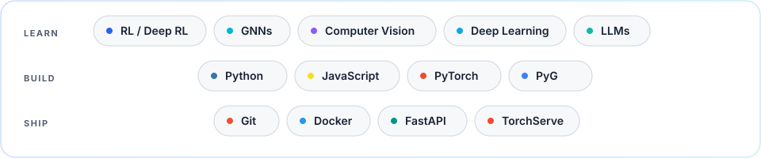

  

  <a href="mailto:alietemadfard@gmail.com">Email</a>
  &nbsp;&nbsp;·&nbsp;&nbsp;
  <a href="https://www.linkedin.com/in/etemadfard/">LinkedIn</a>
  &nbsp;&nbsp;·&nbsp;&nbsp;
  Tehran, Iran

### About

M.Sc. student in **Artificial Intelligence** at Amirkabir University of Technology and an AI developer with professional experience in **computer vision** and **graph neural networks**. My earlier work spans satellite imagery and geometric reconstruction; I am now focused on learning systems that adapt through interaction and demonstration.

### Research interests

`Reinforcement Learning` &nbsp; `Deep RL` &nbsp; `Meta-RL` &nbsp; `Imitation Learning`

### Core stack

  

### Research direction

Building toward adaptive agents that combine sequential decision-making, structured representations, and language-based reasoning.

> **Currently exploring** — reinforcement learning, imitation learning, and the role of LLMs in adaptive agents.
